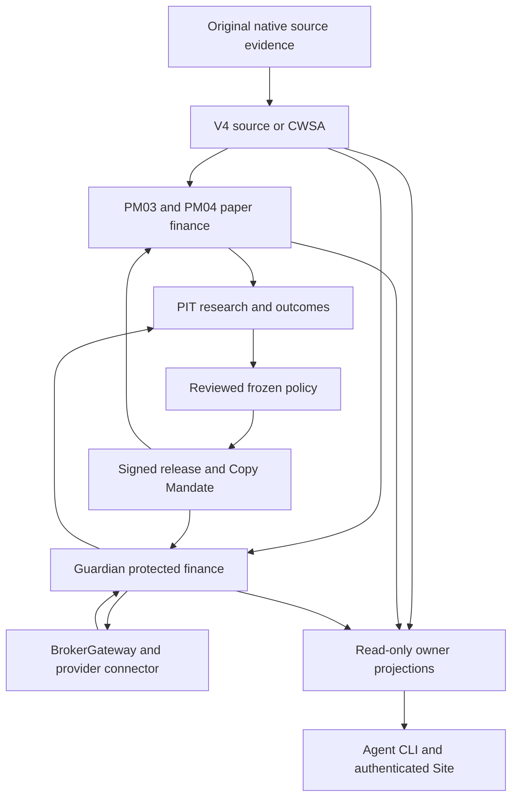

# System architecture and authority map

**Role:** CURRENT OWNERSHIP CONTRACT. This page explains how the existing system fits together; it does not attest a deployment. Proposed agent-facing improvements and their implementation frontier live in [Agent system design](AGENT-SYSTEM-DESIGN.md). Use [INDEX](INDEX.md) to reach the relevant runbook and [CONTEXT](../CONTEXT.md) for domain meanings.

## Purpose and operating model

The system converts selected-source observations into independently controlled follower experiments and, only under separate protected authority, financial actions. Research decides what merits evaluation. Source authorities establish what was actually known. Signed releases constrain the policy. Each financial consumer owns its own admission, effects and uncertainty. Provider adapters report native facts. Operator interfaces expose those owners without replacing them.

There are two connected feedback loops. The operating loop observes, assesses, applies an authorized owner-local action and verifies its effect. The research loop turns frozen observations and outcomes into falsifiable studies, retained findings and proposed future policy versions. A research conclusion enters the operating loop through a separately reviewed release or mandate; a dashboard recommendation cannot activate itself.

The diagram shows responsibility and evidence flow, not an assertion that every route is installed or authorized. The provider route remains subject to account-specific execution proof and Guardian permission. Shared source evidence does not create shared financial state or a transaction spanning consumers.

## Linked abstractions

| Abstraction | Meaning | Next boundary |
| --- | --- | --- |
| Identity, scope and time | Exact source account/DEX, portfolio/version, mandate generation, consumer run and original clocks | A claim can be checked against the right original evidence |
| Evidence | Original receipt plus provenance and immutable identity | Its owner determines what state transition it supports |
| Owned state | Registry metadata, source continuity, consumer finance, provider facts or runtime observations | An operation assesses only its applicable prerequisites |
| Assessment | Evidence and blockers for one requested operation | The state owner independently checks permission and preconditions |
| Action and effect | A local durable decision, financial intent, research job or permitted configuration change | Independent postcondition/reconciliation evidence |
| Retained knowledge | Reproducible result, negative finding, regression or corrected contract | Less reconstruction in the next task; no implicit runtime promotion |

The [target design](AGENT-SYSTEM-DESIGN.md) specifies richer discovery and scoped explanations. Existing commands and known limitations are documented in [agent operations](AGENT-NATIVE-OPERATIONS.md); conceptual steps are not new CLI commands.

## Authority map

| Question or effect | Existing owner | Canonical boundary |
| --- | --- | --- |
| Wallets, aliases, exclusions, cohorts and sealed portfolio versions | `wallet_registry` and private SQLite | [Registry-first workflow](WALLET-REGISTRY-AGENT-WORKFLOW.md); native inventory identity, historical known-at and protected writes |
| Original source receipt, scope and first-known clock | Native source/stream journals and source exporters | [Position-first ADR](decisions/2026-11-08-position-first-t300.md), [source export](V4-PROP-SOURCE-EXPORT-20261108.md) |
| Canonical sampled checkpoint outcome and target change | `pm_checkpoint_source`, `pm_checkpoint_journal` | [CWSA design](decisions/2026-11-11-canonical-5m-checkpoint-grill.md), [implementation ledger](CANONICAL-5M-IMPLEMENTATION-313.md) |
| Frozen leader-to-follower relationship | `pm_copy_mandate`, existing release and consumer verification | Signed Copy Mandate; source epoch and follower mandate generation remain distinct |
| Virtual account finance, attribution and risk | PM03/PM04 and each independent `PaperJournal` | [PM03](PM-03-shadow-account.md), [PM04](PM-04-shadow-hardening.md); modeled effects, no broker authority |
| Chapter 2 waves, paper admission and presentation | `pm_cwsa_chapter2_*`, `pm_cwsa_six_paper` delegating finance to PM03 | [Chapter 2 runbook](CWSA-CHAPTER2-20261112.md); receipts/projections are not a second ledger |
| Protected follower finance and real intent identity | prop-production Guardian, financial journal, release verification and BrokerGateway | Companion `CONTEXT.md`, `docs/CHECKPOINT-INTEGRATION-325.md`, `docs/DEPLOYMENT-RUNBOOK.md` |
| Provider identity, transport, native quantities and uncertainty | trading-connector provider modules | Companion `docs/architecture.md`, native evidence and account/instrument execution-capability contracts |
| Historical screening and immutable research jobs | `pm_offline_job`, Polars research and existing data adapters | [Data acquisition](DATA-ACQUISITION.md), [runbook](RUNBOOK.md), [offline acceptance](OFFLINE-MILESTONE2-ENGINEERING-ACCEPTANCE-20261104.md) |
| Wallet/strategy health and proposed frozen k | Existing Track B and Track C research owners | [Track B](WALLET-HEALTH-TRACK-B-20261110.md), [Track C](TRACK-C-K-RECALIBRATION-20261110.md); advisory research |
| Scientific/economic qualification | Original matched follower evidence and independent verification | [Qualification](QUALIFICATION.md), [governance](GOVERNANCE-GATES.md); no self-issued alpha |
| Software-operation discovery and read composition | `pm_capabilities`, `pm_operations` | [Agent operations](AGENT-NATIVE-OPERATIONS.md); descriptive catalog, no new permission |
| Installed and running release facts | Existing release controllers plus `pm_runtime_readonly` and independent OS evidence | [Registry release](WALLET-REGISTRY-RELEASE-RUNBOOK.md), owning deployment runbook; configured, installed and running are separate |
| Cross-repository companion/schema pins | prop-production `src/prop_production/compatibility.json` | Sole pin authority; recheck the exact application candidate and installed bundle |
| Operator presentation | Authenticated Site consuming privacy-safe read models | [Chapter 2 dashboard contract](CWSA-CHAPTER2-20261112.md); Site publisher/source lineage checked independently |

Companion paths are repository locators, not assumed sibling directories. Resolve the intended checkout and exact revision before following them. Research/source package code cannot alter Guardian-owned finance or bypass provider restrictions.

## Source policies are distinct

| Policy | Source event and timing | Preserved boundary |
| --- | --- | --- |
| V4 event-driven T0+300 | Genuine first locally known complete selected-position transition; one new-risk attempt at its original T0 + 300 seconds; verified reductions/protective exits are immediate | [Binding V4 ADR](decisions/2026-11-08-position-first-t300.md); no reconnect or retry creates a new T0 |
| CWSA sampled five-minute policy | Official native REST complete selected-account/required-DEX checkpoint; real eligible target change; source-driven entries and exits follow the grid | [CWSA ADR](decisions/2026-11-11-canonical-5m-checkpoint-grill.md); missing/initial/recovery books are nonopening baselines; independent follower protection remains active |
| Vike transport/research | Raw wallet activity and comparison evidence; future scalable transport direction | [Vike-first ADR](decisions/2026-11-11-vike-first-wallet-source.md), [migration evidence](V4-VIKE-FIRST-MIGRATION-PROGRESS-20261111.md); transport observations alone do not qualify official continuous source truth |
| Historical fill/minute screening | Retrospective oracle/proxy clocks and causal market approximations under declared assumptions | [Fast screening](V4-FAST-POLARS-SCREENING-20261110.md); not prospective first-known or executable follower evidence |

Installed source policy must be established from the actual release and journal, not this table. A new strategy has its own release, timing and economic qualification; code availability does not cut over the old strategy.

## Invariants across the system

- **Identity is lossless:** venue, native market/DEX, selected account, qualified portfolio/version, consumer and signed policy stay bound. An alias or database-local integer is not a universal identity.
- **Clocks retain their meaning:** provider event time, first local receipt, scheduled checkpoint, validation, publication and decision time are separate. Late data cannot become earlier knowledge.
- **Missing is explicit:** unavailable data is neither verified flat nor zero P&L. Integrity, completeness, freshness, continuity and authorization are independent dimensions.
- **Fixed-k is the default:** source native quantity × independently verified source mark × frozen k determines target notional; an independent follower quote determines destination quantity. Follower equity/risk remains mandatory. Source whole-wallet NAV is required only for explicit legacy `ALLOCATION_OVER_LIVE_NAV`. See [sizing](RISK-BUDGETED-K-SIZING-20261106.md).
- **Effects have one owner:** source target, registry seal, research result, paper intent and Guardian intent are different objects. No duplicate finance, global state machine or cross-journal exactly-once claim.
- **Uncertainty survives restart:** possible broker dispatch retains intent, reservation, attribution and HALT until independent reconciliation. Source health, mandate pause or code rollback cannot erase old exposure.
- **Proof does not imply permission:** valid schema, hash, signature, healthy process and passing tests each prove only their own property. Qualification and action-specific authorization remain separate.
- **Private evidence stays private:** expose redacted references, bounded diagnostics and original hashes; keep raw identities, keys, journals and provider account responses outside Git.

## Storage, computation and orchestration

SQLite remains the metadata and owner-local transactional journal technology. Separate stores have separate meanings; a UI/status cache is a replaceable projection. Source/consumer progress and that consumer's effect commit under the existing local transaction rules; transport delivery does not attest all consumers' effects.

Original raw evidence and immutable Parquet/job artifacts support research. The canonical wallet store (`copytrade_pm.wallet_store`, Hive Parquet + SQLite `catalog.sqlite`; see [wallet store](WALLET-STORE.md)) stores normalized fills and positions for `scan`/`coverage`/`verify`/`ingest`, while Polars/DuckDB and existing ML4T/data adapters handle bounded bulk work (including the completed two-DEX [Reservoir acquisition](RESERVOIR-WALLET-DUCKDB-PLAN-20261112.md) and [269-wallet runbook](RESERVOIR-MONITORED-PLUS-SIX-269-20261112.md)) and PM03/PM04 retain deterministic financial replay (see [the 5-minute follower backtest](FOLLOWER-5M-BACKTEST-20261112.md) for in-sample exposure sensitivity). Run `copytrade-pm capabilities list` before any data acquisition, replay or backtest — the catalog names the native owner for each step (`source.vike_selected_fills`, `historical.replay`, `research.polars`, `wallet_store`) so discovery comes before building a parallel path. Exact input scope and dependency hashes govern reuse. Only untracked Site prototype files in `/home/quant/dev/copytrade-pm/dashboard/` remain outside `main` (see [INDEX](INDEX.md#current-specialist-contracts)).

For `pm_cwsa_six_paper`, `PORTFOLIO_CONFIGS` records supervisor parameters (`starting_balance`, `nominal_risk`, `pod_risk`, `sizing_contract`), while private SQLite remains the membership/version authority and `k` lives only in signed copy mandates (`copy_mandate_heads`), never inferred from risk budgets or anchors. Independent release checkouts under `~/.local/share/copytrade/releases/` should be excluded from repository-wide searches.

[Prefect](TRACK-B-PREFECT-ORCHESTRATION-20261110.md) is optional research orchestration. It does not own the hot source stream, financial state or broker permissions. Optional ML4T connector bridges remain independent compatibility consumers; the native Guardian route never adopts their journal as protected intent truth.

## Agent and operator access

Start with the question and scope, discover the existing operation, inspect its owner evidence, then act and verify within authorization. Metadata-only work need not inspect private financial journals. Runtime questions require independent runtime evidence; financial questions require their financial owner. The [registry workflow](WALLET-REGISTRY-AGENT-WORKFLOW.md) and [agent operations](AGENT-NATIVE-OPERATIONS.md) specify available routes and current diagnostic defects.

The intended operator UI is the authenticated Site. Preserve untracked or concurrent frontend work until ownership is established. Historical Grafana/Marimo work and the older Ops Control Center are not proof of current Site parity. Both CLI and Site should show source/finance/permission separately and retain null unknown economics.

Current code, desired behavior and observed deployment answer different questions. Read an approved ADR for intent, the exact candidate and tests for implementation, original receipts for evidence, and the verified installed/process state for runtime. Resolve contradictions at the owning boundary instead of declaring the newest document universally authoritative.

## Evidence and historical continuity

Keep IMPLEMENTED, ENGINEERING_VERIFIED, MERGED, DEPLOYED, PROSPECTIVE_PAPER_ACTIVE, ECONOMICALLY_QUALIFIED, SCIENTIFICALLY_QUALIFIED and TRADING_AUTHORIZED separate. The [merge-versus-runtime ADR](decisions/2026-11-10-merge-vs-runtime-promotion.md) and [Chapter 2 runbook](CWSA-CHAPTER2-20261112.md) own their respective gates.

Dated PM01/PM02, historical NAV-relative replay, Trader Intelligence, public-trade canaries, old ML4T migration proposals and early forward-paper checkpoints retain their original assumptions. Reach them through [INDEX](INDEX.md). Their counts, legacy paths and then-unimplemented statements are historical evidence, not current architecture requirements.

The [architecture at the pre-revision source](https://github.com/hzminhzz/copytrade-pm/blob/1c4ac38e76dc7ed31e3421273269750b2f03e086/docs/ARCHITECTURE.md) preserves the chronological implementation narrative removed from this entry point. Specialist contracts and scientific results remain intact.
