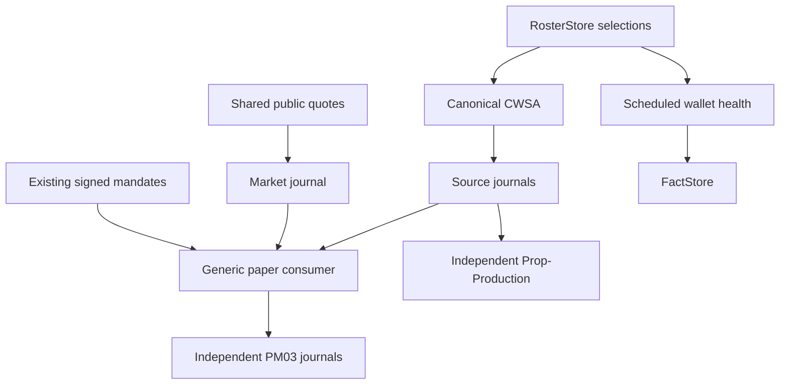

# Single-owner Copytrade Appliance

Current ownership contract. The [decision record](decisions/2026-11-28-single-owner-appliance.md) explains the reconstruction and retirement boundary.

## Runtime

One clean canonical checkout and its `.venv` supply every retained worker. The committed `uv.lock` pins the environment. Native systemd supervises three long-running roles and one scheduled health operation through `copytrade-pm.target`.

| Role | Responsibility | State owner |
| --- | --- | --- |
| Source | Configured CWSA observation over all retained source epochs, with a shared public request budget | Independent canonical source journals |
| Quotes | One public acquisition for the configured instrument union | Independent market evidence journal |
| Paper | Generic configured portfolio consumption | Independent PM03 account journals and signed mandates |
| Health | One daily public wallet-health capture | FactStore and immutable raw health generations |

Source and paper groups retain independent owner journals even when one process schedules them. A portfolio label never selects a software release. Existing paths remain where signatures or independent consumers require them; directory names are historical data lineage.

## Evidence and authority

Source outcomes own observation identity and first-known clocks. Gaps remain explicit. PM03 owns financial state and uses the pinned shared kernel semantics. Each signed mandate fixes its owner, scope, coefficient and policy. Software updates do not create or sign financial policy.

FactStore remains the point-in-time research authority. RosterStore's researched seat books remain separate from adopted observation membership. A membership seal proves which wallets were observed; it does not prove useful predictive evidence, approved k or executable follower PnL.

The former Chapter 2 source service name is only a systemd alias to the canonical source role because an independent Prop-Production unit depends on that name. Its source database path is unchanged. Appliance lifecycle operations never stop, restart or edit Prop-Production services.

## Configuration and storage

The private root contains `appliance.json`, `roster.sqlite`, `facts/`, owner journals, health evidence, operational receipts and backups. Configuration paths must remain within this root, with private permissions and no symlink traversal. Source configurations and financial approval bundles retain exact content pins. Multiple writers cannot own the same configured root.

Roster schema 2 adds immutable observation selections. Explicit adoption records the original seal and selection clock, the original snapshot SHA and a new store adoption clock. Reads before adoption cannot see that membership. Batch adoption is atomic and idempotent. It creates no researched leases or scorecards.

## Operations and failure

The existing CLI wraps git, uv and systemd directly. Reconciliation renders native units from validated configuration. Recovery restarts the target and relies on each journal's durable cursor. Update accepts only a clean, fully verified candidate already incorporated into main, fast-forwards the canonical checkout, synchronizes the frozen environment and restarts the target. On failure it restores the prior software revision and environment; financial and source journals continue forward.

Status distinguishes code identity, process identity, source scope coverage, per-instrument quote freshness, paper account cursors and roster integrity. Operational health is independent of financial admission and scientific qualification.

## Removed mechanisms

There is no web dashboard, Site publisher, Prefect scheduler, worker release selector, deployment controller, standby supervisor or historical experiment service. Retired financial interpreters required for original journal replay remain library code; obsolete runners and deployment paths do not.

Historical documentation, data and Git ancestry remain evidence. The outstanding frozen forward assessment due 2026-12-02 remains an unresolved research obligation when its old timer is retired. Retirement does not score its holdout or declare it complete.
